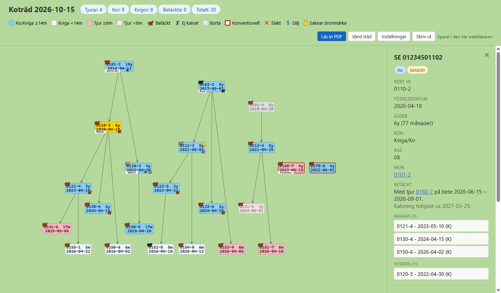

# Koträdet

Stamträd för en nötdjursbesättning, ritat från utdrag ur CDB (Jordbruksverkets
centrala djurdatabas). Öppna det på <https://hugoflordal.github.io/kotradet/>.

*Skärmbilden visar en påhittad besättning.*

CDB har inget API, så det enda sättet för ett program att komma åt uppgifterna är
genom de utdrag som djurhållaren själv kan ladda ned. Man hämtar därför utdraget
*Djurinnehav* som PDF från CDB varje gång något ändras i besättningen, till exempel
när djur föds, köps, säljs eller flyttas till eller från bete. Koträdet läser in utdragen och ritar ett träd där varje djur sitter under sin
mor, ordnat efter födelseår. Genom att jämföra utdragen över tid räknar det ut:

- **Borta:** djur som har försvunnit ur besättningen (sålda, slaktade eller döda).
- **Betäckt:** kor och kvigor från 14 månader som har gått på sommarbetet samtidigt
  som en tjur från 6 månader, med betesperiod, tjur och tidigaste kalvning.
- **Ej kalvat:** ett svart kryss för varje betesperiod med tjur som inte gav någon
  kalv inom 10 månader.
- **Far:** tjuren som gick med mamman på betet när kalven blev till.
- **Konventionell:** djur som ännu inte är omställda till ekologiska, och datumet då
  de blir det.

På varje djurs kort kan man dessutom sätta namn, färg (svart, grå, ljusbrun eller
Hereford-röd), saknade öronmärken, att djuret ska slaktas eller säljas och en
kommentar. Allt visas som små symboler i trädet.

## Sidan

Mappen `web/` är en webbsida som körs helt i webbläsaren. Man läser in utdragen som
PDF på sidan (eller drar dit dem), ställer in sommarbete och omställningsdatum under
*Inställningar* och sätter anteckningar direkt på djuren. PDF:erna tolkas i
webbläsaren och laddas aldrig upp. Det som läses ut ur dem sparas automatiskt, på
användarens konto när man är inloggad (se nedan) och annars i webbläsaren. På
telefon lägger sig trädet på andra ledden och djurets kort glider upp nerifrån.
Gamla anteckningar från `notes.json` kan importeras under *Inställningar*.

Provkör lokalt med `make web` och öppna `http://localhost:8001/`. Sidan behöver
ingen byggprocess: `index.html`, `app.js`, `kotrad.js` och `storage.js` kan läggas
på vilken webbserver som helst.

- `kotrad.js`: tolkning av utdragen och analysen av besättningen (rena funktioner).
- `storage.js`: var datan sparas: i webbläsaren, eller på användarens konto i
  Supabase när `config.js` har en nyckel.
- `config.js`: Supabase-projektets adress och publika nyckel. Tom nyckel betyder
  att allt bara sparas i webbläsaren.
- `app.js`: sidan, med PDF-läsning (pdf.js), layout (Graphviz som WebAssembly) och
  ritning (Cytoscape.js).

## Inloggning och lagring (Supabase)

Med en nyckel i `config.js` loggar man in med en länk i mejlet, och allt sparas på
kontot i tabellen `herds`. Varje användare kan bara läsa och skriva sin egen rad.
Uppsättning:

1. Kör `supabase/schema.sql` i Supabase → SQL Editor.
2. Lägg projektets publika nyckel (anon/publishable) i `web/config.js`. Den får vara
   publik; `service_role`-nyckeln får aldrig hamna här.
3. Authentication → URL Configuration: Site URL och Redirect URLs =
   sidans adress (t.ex. `https://hugoflordal.github.io/kotradet/`) och
   `http://localhost:8001/`.
4. Logga in en gång och stäng sedan av nya registreringar om ingen annan ska
   använda sidan.

Sidan publiceras på GitHub Pages av `.github/workflows/pages.yml` (Settings →
Pages → Source: GitHub Actions). Gratisplanen i Supabase har inga backuper att
återställa själv: använd *Exportera allt* under *Inställningar*.

## Data

Utdragen innehåller djurhållarens personnummer och produktionsplatsnummer. Lägg aldrig
PDF-filer, exporter (`kotradet-*.json`) eller `notes.json` i repot. `.gitignore`
stoppar dem.
